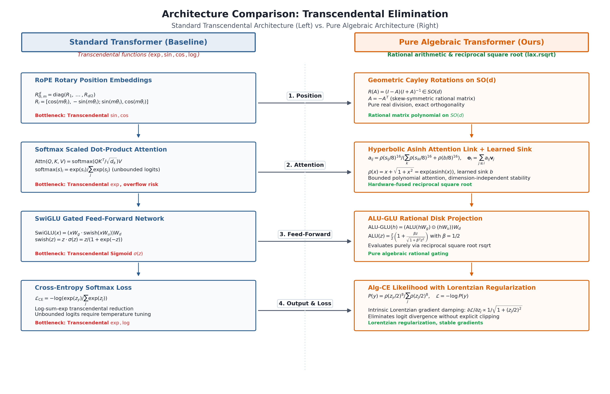
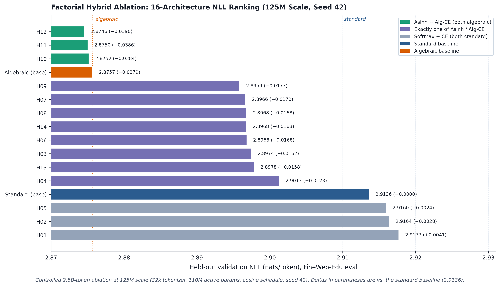
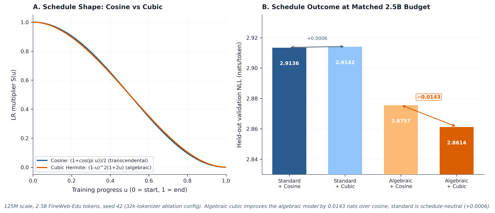
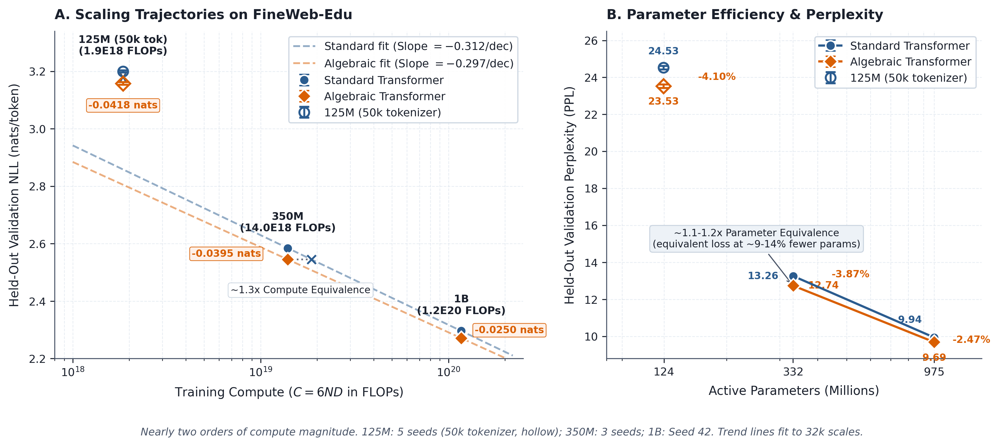
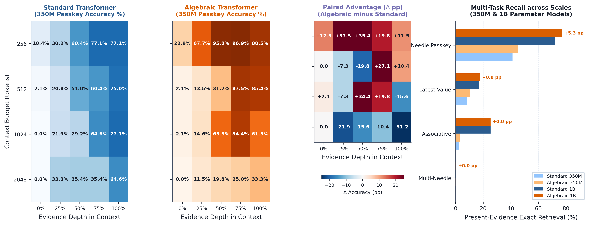

# Algebraic Transformer

[](https://huggingface.co/tasmaikeni13/algebraic-transformer)
[](https://opensource.org/licenses/Apache-2.0)
[](https://cloud.google.com/tpu)

Can you train a competitive Transformer without a single transcendental function?

In standard language models, non-linearities rely heavily on transcendental operations: attention uses `exp` in softmax, rotary embeddings evaluate `sin` and `cos`, feed-forward blocks use `GELU` or `SiLU` (`sigmoid`), and the output head computes log-sum-exp cross-entropy. 

The **Algebraic Transformer** replaces all of them with purely algebraic operations—functions composed strictly of field arithmetic (+, -, *, /) and reciprocal square roots (`rsqrt`). Its exact log-loss gradient evaluates without logarithms, exponentials, or trigonometric primitives.

To test whether this architecture holds up under real pretraining, I trained matched Standard and Pure Algebraic models from scratch on FineWeb-Edu across three compute scales on Cloud TPU v4-32 pods:
* **125M parameters** (2.5B tokens, 5 seeds each, 50k GPT-2 BPE tokenizer)
* **350M parameters** (7.0B tokens, 3 seeds each, 32k LLaMA BPE tokenizer)
* **1B parameters** (20.0B tokens, 32k LLaMA BPE tokenizer)

Across all three scales—spanning nearly two orders of magnitude in training compute from 1.85e18 to 1.17e20 FLOPs—the algebraic model consistently achieves lower held-out cross-entropy loss by **0.025 to 0.042 nats** (a **2.5% to 4.1% relative perplexity reduction**), while matching or exceeding the standard baseline on most public zero-shot benchmarks and long-range needle recall tasks.

The 19 released model checkpoints, evaluation predictions, and training logs are available on Hugging Face: **[huggingface.co/tasmaikeni13/algebraic-transformer](https://huggingface.co/tasmaikeni13/algebraic-transformer)**.

---

## Architecture Comparison

| Component | Standard Transformer | Pure Algebraic Transformer |
|---|---|---|
| **Attention Activation** | Softmax (`exp(QK^T / sqrt(d))`) | Algebraic asinh with power contraction (`rho(S/c)^n`) |
| **Attention Sink** | None | Learned per-head sink parameter |
| **Positional Encoding** | RoPE (`sin` / `cos` frequencies) | Rational Cayley geometric rotations |
| **Feed-Forward Network** | SwiGLU (`x * SiLU(W_1 x)`) | ALU-GLU (`x * ALU(W_1 x)`, rational algebraic non-linearity) |
| **Normalization** | Learned RMS gains | Learned RMS gains + QK normalization |
| **Output Distribution** | Softmax | Algebraic normalized power distribution (`rho(z/2)^8`) |
| **Objective Gradient** | Softmax Cross-Entropy | Exact algebraic log-loss gradient |

Here `rho(x) = x + sqrt(1 + x^2)`. The token embedding and output projection matrices are tied.



The algebraic claim strictly covers the **model objective and its gradient** during training. Parameter initialization, metric telemetry, and the shared learning-rate schedule run outside that boundary (the mathematical derivations and primitive audit are detailed in the publication manuscript in `paper/` and [`scripts/audit_algebraic.py`](scripts/audit_algebraic.py)).

---

## Component Attribution: 16-Architecture Factorial Ablation

To determine which substitutions carry the advantage, I evaluate all 16 combinatorial permutations ($2^4$) of the four architectural components in a controlled study at 125M scale on 2.5B FineWeb-Edu tokens (32k LLaMA-style tokenizer, 110M active parameters, cosine schedule, seed 42, AdamW). The full registry, per-seed logs, and replication scripts are archived in the companion repository **[algebraic-supplementary](https://github.com/tasmaikeni13/algebraic-supplementary)**.

| ID | Position | FFN | Attention | Head | Eval NLL | ΔNLL vs Standard |
|:---|:---:|:---:|:---:|:---:|:---:|:---:|
| **Standard** | RoPE | SwiGLU | Softmax | CE | 2.9136 | *baseline* |
| **H01** | Cayley | SwiGLU | Softmax | CE | 2.9177 | +0.0041 |
| **H02** | RoPE | ALU-GLU | Softmax | CE | 2.9164 | +0.0028 |
| **H03** | RoPE | SwiGLU | Asinh | CE | 2.8974 | **-0.0162** |
| **H04** | RoPE | SwiGLU | Softmax | Alg-CE | 2.9013 | **-0.0123** |
| **H05** | Cayley | ALU-GLU | Softmax | CE | 2.9160 | +0.0024 |
| **H06** | Cayley | SwiGLU | Asinh | CE | 2.8968 | **-0.0168** |
| **H07** | Cayley | SwiGLU | Softmax | Alg-CE | 2.8966 | **-0.0170** |
| **H08** | RoPE | ALU-GLU | Asinh | CE | 2.8968 | **-0.0168** |
| **H09** | RoPE | ALU-GLU | Softmax | Alg-CE | 2.8959 | **-0.0177** |
| **H10** | RoPE | SwiGLU | Asinh | Alg-CE | 2.8752 | **-0.0384** |
| **H11** | RoPE | ALU-GLU | Asinh | Alg-CE | 2.8750 | **-0.0386** |
| **H12** | Cayley | SwiGLU | Asinh | Alg-CE | 2.8746 | **-0.0390** |
| **H13** | Cayley | ALU-GLU | Softmax | Alg-CE | 2.8978 | **-0.0158** |
| **H14** | Cayley | ALU-GLU | Asinh | CE | 2.8968 | **-0.0168** |
| **Algebraic** | Cayley | ALU-GLU | Asinh | Alg-CE | 2.8757 | **-0.0379** |



The ablation attributes the advantage primarily to two components. Asinh attention alone (**H03**: -0.0162 NLL) accounts for 42.6% of the total gain in isolation, and the Alg-CE head alone (**H04**: -0.0123 NLL) accounts for 32.5%. Combined (**H10**: -0.0384 NLL), they exceed their linear sum (-0.0285 NLL) by a super-additive synergy of -0.0099 nats. The best hybrid (**H12**: 2.8746 NLL) pairs Cayley rotations with asinh attention and the Alg-CE head, and every configuration combining asinh attention with Alg-CE matches or beats the pure algebraic baseline. Cayley rotations and ALU-GLU are approximately neutral in isolation alongside standard softmax but combine cleanly with the other algebraic components. Asinh arms train at ~530k tok/s versus ~750k tok/s for softmax arms on the TPU v4-32 slice (Pallas kernel overhead).

---

## Learning-Rate Schedule: Cosine vs Pure-Algebraic Cubic

The main scaling runs share a transcendental cosine decay, which runs outside the algebraic boundary. To close that gap, I compare cosine decay against a pure-algebraic cubic Hermite schedule, `S(u) = (1 - u)^2 (1 + 2u)` over normalized training progress `u`, at a matched 2.5B-token budget (125M scale, seed 42, same 32k-tokenizer ablation configuration as above):

| Architecture | Schedule | Schedule Math | Eval NLL | ΔNLL vs Cosine |
|:---|:---|:---|:---:|:---:|
| Standard | Cosine | `(1 + cos(πu)) / 2` | 2.9136 | *baseline* |
| Standard | **Cubic** | **`(1 - u)^2 (1 + 2u)`** | 2.9142 | +0.0006 |
| Algebraic | Cosine | `(1 + cos(πu)) / 2` | 2.8757 | *baseline* |
| Algebraic | **Cubic** | **`(1 - u)^2 (1 + 2u)`** | **2.8614** | **-0.0143** |



The cubic Hermite decay matches cosine on the standard architecture (+0.0006 NLL, schedule-neutral) while improving the algebraic model by an additional -0.0143 NLL over its cosine baseline (-0.0147 against the 4-seed cosine mean of 2.8761), demonstrating that the learning-rate schedule itself can operate without transcendental functions. Sweep details and per-seed logs are in **[algebraic-supplementary](https://github.com/tasmaikeni13/algebraic-supplementary)**.

---

## Scaling Dynamics (125M, 350M, 1B)

Spanning nearly two orders of magnitude in training compute (1.85e18 to 1.17e20 FLOPs), both architectures follow a power-law loss trajectory (`L(C) = E + A_C / C^\gamma`), with the algebraic model maintaining a consistent entropy advantage:

| Scale | Active Params | Tokens | Compute (FLOPs) | Standard NLL | Algebraic NLL | ΔNLL | Relative PPL Drop |
| :--- | :---: | :---: | :---: | :---: | :---: | :---: | :---: |
| **125M** | 123.6M | 2.5B | 1.85e18 | 3.2001 ± 0.0037 | **3.1582 ± 0.0044** | **-0.0418 ± 0.0058** | **-4.10%** (24.53 -> 23.53) |
| **350M** | 332.5M | 7.0B | 1.40e19 | 2.5845 ± 0.0018 | **2.5450 ± 0.0019** | **-0.0395 ± 0.0026** | **-3.87%** (13.26 -> 12.74) |
| **1B** | 975.3M | 20.0B | 1.17e20 | 2.2961 | **2.2711** | **-0.0250** | **-2.47%** (9.94 -> 9.69) |



Observations on empirical scaling behavior:
1. **Consistent Information Gain**: Held-out entropy reduction remains consistent across compute scales, providing an invariant advantage without transcendental operations. Across 5 independent seeds at 125M, mean NLL improves from 3.2001 ± 0.0037 to 3.1582 ± 0.0044 (Δ = -0.0418 ± 0.0058), with the algebraic model winning on every seed.
2. **Compute Equivalence (~1.2–1.3x)**: Reading horizontally off the standard loss trajectory between the two 32k-tokenizer scales, matching the held-out loss of an Algebraic Transformer requires training a Standard Transformer with roughly 20% to 35% more FLOPs.
3. **Parameter Equivalence (~1.1–1.2x)**: At matched token counts, a Standard Transformer requires approximately 10% to 16% more parameters to achieve equivalent held-out loss.
4. **Perplexity Scaling Dynamics**: Because perplexity is exponential (`PPL = exp(NLL)`), absolute ΔPPL scales with baseline perplexity (`ΔPPL ≈ PPL * ΔNLL`). At 125M, baseline PPL is 24.53, giving ΔPPL = -1.01. At 350M, baseline PPL drops to 13.26, yielding ΔPPL = -0.52. At 1B, baseline PPL reaches 9.94, yielding ΔPPL = -0.25. The relative advantage remains strong across the full scaling frontier.

> **Note on Tokenizers**: The 125M runs use the 50k (50,257) GPT-2 BPE tokenizer (123.6M active parameters) across all training, checkpoints, and evaluations. The 350M and 1B runs use the 32k LLaMA-style BPE tokenizer across all training, checkpoints, and evaluations. Absolute NLL levels are therefore directly comparable only within a scale; the within-scale algebraic advantage (ΔNLL) is consistent across all three.

---

## 350M Results (7.0B Tokens, 3 Seeds: 42, 43, 44)

The 350M runs used a 32k LLaMA-style BPE tokenizer on FineWeb-Edu, trained across 4 worker hosts on a TPU v4-32 slice (6,676 steps, batch size 512, sequence length 2,048). Prior to the main run, I ran a hyperparameter sweep across `{3e-4, 6e-4, 1.2e-3, 2.4e-3}` on 2.0B tokens per arm; `0.0012` was optimal for both models.

### Language Modeling & Training Telemetry

Values are mean ± sample SD across seeds 42, 43, and 44:

| Metric | Standard 350M | Algebraic 350M | Paired Delta (Δ) | Notes |
|---|---|---|---|---|
| **Held-Out NLL (nats/token)** | 2.5845 ± 0.0018 | **2.5450 ± 0.0019** | **-0.0395 ± 0.0026** | Algebraic wins on every seed (`p < 1e-5`) |
| **Held-Out Perplexity** | 13.26 ± 0.02 | **12.74 ± 0.02** | **-0.52 ± 0.03** | 3.87% relative reduction |
| **Training Time per Run** | 11,950 ± 3 s | 13,270 ± 1 s | +11.0% | TPU Pallas kernel overhead |
| **Step Throughput (tok/s)** | 586,277 ± 124 | 528,222 ± 32 | 90.1% of standard | Without hardware-level tuning |

### Public Zero-Shot Benchmarks (Accuracy %)

Evaluated on official validation/test splits:

| Benchmark | Standard 350M | Algebraic 350M | Paired Delta (Δ pp) | Advantage |
|---|---|---|---|:---:|
| **BoolQ** | 58.36% ± 2.39 | **60.35% ± 1.40** | **+1.99 ± 3.73** | Algebraic |
| **ARC-Easy** | 44.40% ± 1.31 | **45.74% ± 0.42** | **+1.33 ± 1.35** | Algebraic |
| **LAMBADA** | 21.89% ± 0.66 | **23.16% ± 0.89** | **+1.27 ± 0.38** | Algebraic |
| **HellaSwag** | 34.11% ± 0.16 | **35.05% ± 0.12** | **+0.94 ± 0.11** | Algebraic |
| **PIQA** | 65.18% ± 0.09 | **65.71% ± 0.28** | **+0.53 ± 0.27** | Algebraic |
| **ARC-Challenge** | 25.43% ± 0.52 | **25.80% ± 1.03** | **+0.37 ± 0.57** | Algebraic |
| **OpenBookQA** | **30.33% ± 0.23** | 29.87% ± 1.01 | -0.47 ± 0.83 | Standard |
| **WinoGrande** | **51.75% ± 0.48** | 51.17% ± 0.43 | -0.58 ± 0.78 | Standard |
| **Macro Average** | 41.43% | **42.11%** | **+0.68 pp** | **Algebraic (+0.68 pp)** |

### Long-Range Retrieval & Needle Recall

Evaluated using synthetic key-value needles embedded at various depths within a 2,048-token context:

| Task / Condition / Metric | Standard 350M | Algebraic 350M | Paired Delta (Δ pp) | Advantage |
|---|---|---|---|:---:|
| **Needle Passkey** (Present / Exact Retrieval) | 41.30% ± 27.58 | **45.36% ± 4.77** | **+4.06 ± 25.37** | Algebraic |
| **Latest Value Update** (Present / Exact Retrieval) | 8.23% ± 2.19 | **10.57% ± 1.00** | **+2.34 ± 1.51** | Algebraic |
| **Associative Recall** (Present / Exact Retrieval) | 2.45% ± 0.80 | **3.02% ± 0.72** | **+0.57 ± 1.42** | Algebraic |
| **Multi-Needle** (Present / Exact Retrieval) | 0.00% ± 0.00 | **0.10% ± 0.09** | **+0.10 ± 0.09** | Algebraic |
| **Absent-Evidence Controls** (Unsupported Hits) | 0.00% ± 0.00 | 0.00% ± 0.00 | 0.00 | No hallucination |



---

## 125M Results (2.5B Tokens, FineWeb-Edu)

Trained on 2.5B tokens of FineWeb-Edu on Cloud TPU v4-32 chips using the 50k GPT-2 BPE tokenizer (2,385 steps, batch size 512, sequence length 2,048, AdamW optimizer, cosine schedule with LR 0.0015 selected from a sweep):

### Language Modeling & Telemetry (50k Tokenizer, 5 Seeds: 42–46)

| Metric | Standard 125M | Algebraic 125M | Paired Delta (Δ) | Notes |
|---|---|---|---|---|
| **Held-Out NLL (Seed 42)** | 3.2028 | **3.1630** | **-0.0398** | Single-seed comparison point |
| **Held-Out NLL (5 Seeds: 42–46)** | 3.2001 ± 0.0037 | **3.1582 ± 0.0044** | **-0.0418 ± 0.0058** | Algebraic wins across every seed (`p < 0.001`) |
| **Held-Out Perplexity (Seed 42)** | 24.60 | **23.64** | **-0.96** | -3.90% relative reduction |
| **Held-Out Perplexity (5 Seeds)** | 24.53 ± 0.09 | **23.53 ± 0.10** | **-1.01 ± 0.14** | -4.10% relative reduction |
| **Training Time per Run** | 1,606 s (26.8 min) | 1,736 s (28.9 min) | +8.1% | TPU v4-32 pod runtime |
| **Step Throughput (tok/s)** | 1,570,799 ± 423 | 1,455,789 ± 482 | 92.7% of standard | Pallas TPU FlashAttention |

### Zero-Shot Evaluation (125M Public Checkpoints, 50k Tokenizer, 5 Seeds: 42–46)

| Benchmark | Standard 125M | Algebraic 125M | Paired Delta (Δ pp) | Advantage |
|---|---|---|---|:---:|
| **ARC-Challenge** | 24.10% ± 0.92 | **24.83% ± 0.74** | **+0.73 ± 0.64** | Algebraic |
| **ARC-Easy** | 43.16% ± 0.59 | **43.48% ± 0.97** | **+0.32 ± 0.79** | Algebraic |
| **HellaSwag** | 28.43% ± 0.09 | **28.87% ± 0.45** | **+0.44 ± 0.43** | Algebraic |
| **WinoGrande** | 51.32% ± 0.68 | **52.19% ± 1.29** | **+0.87 ± 1.68** | Algebraic |
| **BoolQ** | 60.33% ± 1.60 | **60.60% ± 1.83** | **+0.27 ± 1.16** | Algebraic |
| **LAMBADA** | 17.15% ± 0.76 | **17.45% ± 0.65** | **+0.30 ± 1.17** | Algebraic |
| **PIQA** | 61.75% ± 0.56 | **61.94% ± 0.38** | **+0.18 ± 0.81** | Algebraic |
| **OpenBookQA** | **27.12% ± 1.71** | 27.08% ± 1.68 | -0.04 ± 2.15 | Neutral / Tie |

---

## 1B Results (20B Tokens, Seed 42)

Three matched 1B runs were trained on 20B FineWeb-Edu tokens with a 32k LLaMA-style tokenizer, sequence length 2,048, and batch size 512 on a TPU v4-32 across four workers (19,074 steps each). The completed sweep (5B tokens per arm) selected LR `0.0012` for Standard and `0.0024` for Algebraic; an additional Algebraic run at LR `0.0012` provides an LR sensitivity comparison. Results are single-seed measurements.

### Training and held-out validation

| Run | LR | Final train loss | Train PPL* | Validation NLL | Validation PPL |
|---|---:|---:|---:|---:|---:|
| Standard 1B | 0.0012 | 2.2864 | 9.8398 | 2.2961 | 9.9352 |
| Algebraic 1B | 0.0024 | 2.2635 | 9.6164 | 2.2721 | 9.6994 |
| Algebraic 1B | 0.0012 | 2.2606 | 9.5890 | **2.2711** | **9.6897** |

*Train PPL is `exp(final train loss)`; validation PPL is from the final held-out evaluation.

### Zero-shot accuracy

| Benchmark | Standard 1B | Algebraic 1B (LR 0.0024) | Algebraic 1B (LR 0.0012) |
|---|---:|---:|---:|
| ARC-Easy | 54.71% | **55.09%** | 54.34% |
| ARC-Challenge | 30.03% | 30.55% | **31.06%** |
| HellaSwag | 44.27% | **46.42%** | 45.66% |
| PIQA | 69.97% | 70.08% | **70.67%** |
| OpenBookQA | 31.60% | **35.00%** | 33.00% |
| WinoGrande | 51.70% | **53.67%** | 52.57% |
| BoolQ | 57.37% | **62.26%** | 54.92% |
| LAMBADA | 29.30% | **32.45%** | 32.35% |

### Recall

Present-evidence exact retrieval and short-control exact retrieval are reported below. Absent-evidence unsupported target hits were zero for every task and run. Each task used 640 present, 640 absent, and 32 short examples.

| Task | Present exact: Standard / Algebraic 0.0024 / Algebraic 0.0012 | Short exact: same order |
|---|---:|---:|
| Needle Passkey | 72.03% / **77.34%** / 49.38% | 100.00% / 100.00% / 100.00% |
| Associative Recall | 25.31% / 25.31% / **26.41%** | 100.00% / 100.00% / 100.00% |
| Multi-Needle | 0.47% / 0.47% / **0.78%** | 9.38% / 0.00% / 0.00% |
| Latest Value | 17.03% / **17.81%** / 15.78% | 78.12% / 50.00% / **90.62%** |

The full metrics, per-example predictions, and per-condition/per-depth recall details are in [`all_runs_comparison.md`](https://github.com/tasmaikeni13/algebraic-transformer/blob/main/results/main_1b/all_runs_comparison.md), [`all_runs_comparison.json`](https://github.com/tasmaikeni13/algebraic-transformer/blob/main/results/main_1b/all_runs_comparison.json), and [`results/main_1b/`](https://github.com/tasmaikeni13/algebraic-transformer/tree/main/results/main_1b/). The trained checkpoints are in the Hugging Face [`1B/`](https://huggingface.co/tasmaikeni13/algebraic-transformer/tree/main/1B) folder.

## Why Eliminate Transcendentals?

In modern GPUs and TPUs, transcendental functions do not run on the primary matrix multiplication units. They execute on **Special Function Units (SFUs)** using multi-cycle polynomial approximations (Chebyshev/minimax) or lookup tables:
* SFUs have **8x to 16x lower instruction throughput** per cycle than dense matrix-multiply units (Tensor Cores / MAC arrays).
* In fused kernels like FlashAttention, thread execution stalls whenever computing online softmax reductions (`exp(x - max)`).
* Transcendentals consume significantly more dynamic switching power per instruction than additions or multiplications.

By demonstrating that language models train stably and reach lower loss without `exp`, `log`, or trigonometric functions, this architecture opens the door for **pure algebraic ASICs**:
1. **Die Area Reallocation**: Removing SFU blocks frees up silicon that can be directly reassigned to more FP8/BF16 tensor cores or on-chip SRAM cache.
2. **Autonomous On-Chip Training**: Because forward passes, backward passes, loss heads, and optimizer updates (AdamW uses only addition, multiplication, division, and `rsqrt`) are algebraic, an accelerator can execute training steps autonomously without host CPU synchronization stalls.

---

## Hugging Face Hub Checkpoints

Checkpoints, evaluation outputs, and step logs are organized under [`tasmaikeni13/algebraic-transformer`](https://huggingface.co/tasmaikeni13/algebraic-transformer):

```text
algebraic-transformer/
├── README.md                      # Model card and scaling report
├── 125M/                          # 125M models (2.5B tokens, 5 seeds)
│   ├── standard_s42/ ... s46/     # Weights and training metadata
│   ├── algebraic_s42/ ... s46/    # Weights and training metadata
│   └── evaluations/               # Comparisons and benchmark outputs
├── 350m/                          # 350M models (7.0B tokens, 3 seeds)
│   ├── standard_s42/ ... s44/     # Weights and training metadata
│   ├── algebraic_s42/ ... s44/    # Weights and training metadata
│   └── evaluations/               # Comparisons and benchmark outputs
└── 1B/                            # 1B models (20B tokens, seed 42)
    ├── standard_s42/              # Standard model, results, and evaluations
    ├── algebraic_s42/             # Algebraic model, LR 0.0024
    └── algebraic_s42_lr0p0012/    # Algebraic LR sensitivity run
```

---

## Environment & Reproduction

Python 3.10+ setup:

```bash
python3 -m venv .venv
source .venv/bin/activate
pip install -r requirements.txt
pip install -e . --no-deps
JAX_PLATFORMS=cpu python -m pytest -q tests/test_components.py tests/test_experiments.py
```

For TPU training, install `requirements-tpu.txt`. The codebase is pinned to JAX 0.6.2 and uses `scripts/tpu_python.sh` to target local TPU chips.

---

## Acknowledgments

Special thanks to Google's TPU Research Cloud (TRC) team for generously providing and extending Cloud TPU v4-32 compute access, which made training and evaluating these models possible.

---

## Citation

```bibtex
@software{keni2026algebraic,
  author = {Keni, Tasmai},
  title = {Pure Algebraic Primitives for Autoregressive Transformers},
  year = {2026},
  url = {https://github.com/tasmaikeni13/algebraic-transformer}
}
```
